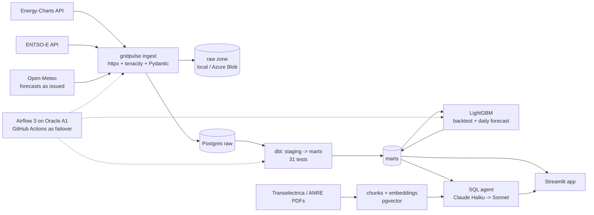

# GridPulse RO

[](https://github.com/cristian102998-arch/gridpulse-ro/actions/workflows/ci.yml)

**A daily data platform and AI assistant for Romania's power system.** It loads public grid data every morning, models it in a tested warehouse, forecasts tomorrow's electricity demand, and answers questions in plain English or Romanian.

> **Live demo:** [open the app](https://gridpulse-ro-d5h6pmzwagutr6majqzw46.streamlit.app/) · **Status:** work in progress, rebuilt in public

<!-- GIF of the app goes here -->

## What it does

An energy analyst at a supplier or trader wants to know, every morning: how much power the country used yesterday, where the peaks were, how much came from renewables, and what tomorrow looks like. GridPulse RO answers that without anyone opening a spreadsheet:

- **Bulletin** – yesterday in five lines, written by Claude from numbers computed in SQL. A guardrail rejects any number the model did not get from the data.
- **Generation mix** – hourly production by source since 2023.
- **Forecast** – a day-ahead load forecast, scored against a naive baseline with confidence intervals and a significance test.
- **Ask the data** – a text-to-SQL agent on a read-only account, plus search over public Transelectrica and ANRE reports with page citations.
- **Status** – every pipeline run, from any scheduler, with data freshness.

## Results so far

| Model, day-ahead load forecast (Oct 2025 – Sep 2026, 365 days, walk-forward) | MAPE | 95% CI |
|---|---|---|
| LightGBM (lgbm-v2) | **4.56%** | 4.07 – 5.11 |
| Seasonal naive (same hour last week) | 7.22% | 6.40 – 8.07 |

LightGBM beats the baseline: Diebold-Mariano test on daily errors, p < 0.0001. The comparison with Transelectrica's own forecast is added once the ENTSO-E feed is connected.

**What did not work as well.** Adding a "next to a public holiday" feature (v2) cut the error on those days from 8.64% to 6.43%, but the gain over the whole year was not significant (p = 0.15). The largest remaining misses are sunny spring middays, when rooftop solar lowers the load the grid sees. Solar irradiance is the next feature to add.

## Architecture



| Layer | Choice | Why |
|---|---|---|
| Ingestion | Python CLI, idempotent upserts per local day | The same command runs from Airflow, GitHub Actions or a laptop |
| Raw zone | fsspec: local folder, Azure Blob in production | Replay any day without calling the API again |
| Warehouse | Postgres 18 (Neon in production) + dbt | Dimensional marts, 31 data tests, docs persisted as column comments |
| Orchestration | Airflow 3, LocalExecutor, on a free Oracle ARM VM | Daily pipeline, monthly backtest, nightly backup |
| ML | LightGBM, walk-forward backtest, block bootstrap, Diebold-Mariano | Honest error bars, no look-ahead (see ADR 0004) |
| LLM | Claude Haiku 5.5 by default, Sonnet 5.5 on failure, Azure OpenAI as a third provider | Model choice backed by an eval, cost measured per question |
| CI/CD | GitHub Actions: lint, tests, dbt build on a 25-hour day, DAG import, Blob tests on Azurite; arm64 images to GHCR | Every PR proves the pipeline still works |

## Things worth a look

- **Time is hard, so it is tested.** Romania has 23- and 25-hour days. Every layer stores UTC and groups by local day, and CI builds the warehouse on 26 October 2025, the 25-hour day ([`tests/`](tests/), [`dbt/tests/`](dbt/tests/)).
- **Zero is not the same as missing.** A dbt check found that the source has no nuclear data at all for September 2026, and no hard coal for October 2023 ([`warn_source_missing_for_whole_day.sql`](dbt/tests/warn_source_missing_for_whole_day.sql)).
- **No look-ahead in the forecast.** Load lags start at 48 hours, and the model only sees the temperature forecast issued 48 hours ahead. A test fails if any feature peeks inside the last 48 hours ([`tests/test_ml_features.py`](tests/test_ml_features.py)).
- **The agent cannot hurt the database.** Model-written SQL must parse as a single SELECT on the `marts` schema, gets a row limit, and runs in a read-only transaction with a timeout, on a role that cannot see raw data ([`sql_guard.py`](src/gridpulse/agent/sql_guard.py)).
- **The eval cannot go stale.** Each of the 25 data questions computes its expected answer with live SQL, and the grader reads English and Romanian number formats ([`evals/agent_questions.yaml`](evals/agent_questions.yaml)).

## Run it locally

```bash
uv sync
createdb gridpulse
uv run gridpulse db init
uv run gridpulse ingest energy-charts public-power --start 2025-01-01   # ~2 minutes
uv run gridpulse ingest open-meteo temperature --start 2025-01-01
cd dbt && uv run dbt build --profiles-dir . && cd ..
uv run gridpulse forecast backtest --months 1
uv run streamlit run app/streamlit_app.py
```

Tests: `createdb gridpulse_test && TEST_DATABASE_URL=postgresql://postgres@localhost:5432/gridpulse_test uv run pytest`. The whole stack with Airflow: [`deploy/docker-compose.yml`](deploy/docker-compose.yml).

## Design decisions

Short ADRs in [`docs/adr/`](docs/adr/): why Airflow runs on a free VM, why Neon, the raw layer, the no-leakage rules, the near-holiday experiment, the model choice for the agent, and the SQL guardrails.

## Data and licences

- Generation and load: [Energy-Charts](https://www.energy-charts.info/) (Fraunhofer ISE), [CC BY 4.0](https://creativecommons.org/licenses/by/4.0/).
- Load, forecast, prices: [ENTSO-E Transparency Platform](https://transparency.entsoe.eu/).
- Weather: [Open-Meteo](https://open-meteo.com/), CC BY 4.0.
- Documents: public reports by Transelectrica and ANRE, linked in [`docs/corpus.yaml`](docs/corpus.yaml).

Code: MIT.
